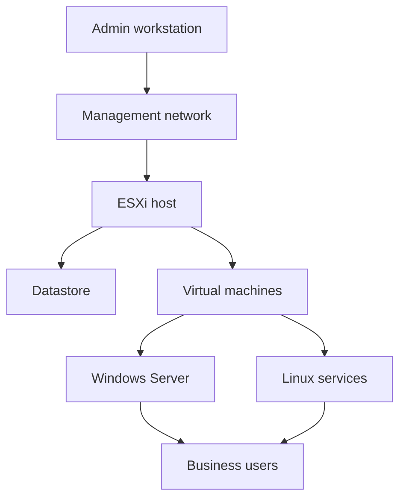

# How I document server and virtualization work

I use these notes for Windows, Linux, VMware, storage, backup and server operations. The aim is simple: someone reading a page should understand the environment, know what the commands do and see what has actually been checked.

## Say what the material is

- **Production experience:** Work I have been involved in, described without company or customer details.
- **Sanitized reference:** A shortened or anonymized procedure or configuration.
- **Lab/demo:** An example I prepared separately. Include the OS or hypervisor release and say which parts were tested.
- **Design note:** An explanation of the setup and its dependencies.
- **Template:** A checklist to adapt, not a record of completed production work.

Do not describe a lab as a production deployment. Do not claim a restore or compatibility test unless it was carried out.

## What to put in a page

Use the sections that help explain the subject. A short, accurate note is better than filling every heading with generic advice.

1. What service, platform or problem is this about?
2. Which OS/build, hypervisor version or hardware assumptions apply?
3. How do the host, network, storage, VM and application depend on one another?
4. What access, backup, approval or maintenance window is needed?
5. Which commands or UI steps are involved?
6. What do the important commands change?
7. What symptoms and logs help narrow down a fault?
8. How was the result checked, including from the user's side?
9. What is the recovery or rollback path?
10. Which vendor references or related notes are useful?

## Example architecture

Change the diagram to match the system being described. Do not add components that are not part of the example.

## Example troubleshooting notes

| Symptom | What I would check | Possible area | How to verify |
|---|---|---|---|
| VM is on, but service is unavailable | VM events, guest logs, listening ports, vNIC and VLAN | Application, guest, network or hypervisor | Test the service from a client |
| Filesystem is full | `df -hT`, `df -i`, logs, LVM state and large directories | Filesystem, storage or application | Check free capacity and application writes |
| SMB share cannot be opened | DNS, TCP 445, SMB logs, share and NTFS permissions | Network, authentication or SMB | Test with an authorized account |
| Restore is uncertain | Backup point, dependencies and isolated restore logs | Backup, recovery or application | Boot, check data and confirm the service |

## Before running or sharing a command

Commands that change partitions, filesystems, firewall rules, permissions, services or storage need pre-checks and a recovery plan. Do not suggest turning off security controls as the first troubleshooting step.

Keep passwords, private keys, recovery codes, internal hostnames/IPs, serial numbers, user data and employer logs out of public pages. If an example has not been tested, say so.

---

**A note on this documentation:** The technical work and experience behind these notes are mine. Some wording and the way I have organized the material have had AI assistance, mainly to make the writing clearer and save time. The examples, decisions and work described are not AI-generated. I check what I publish and stand behind it.
