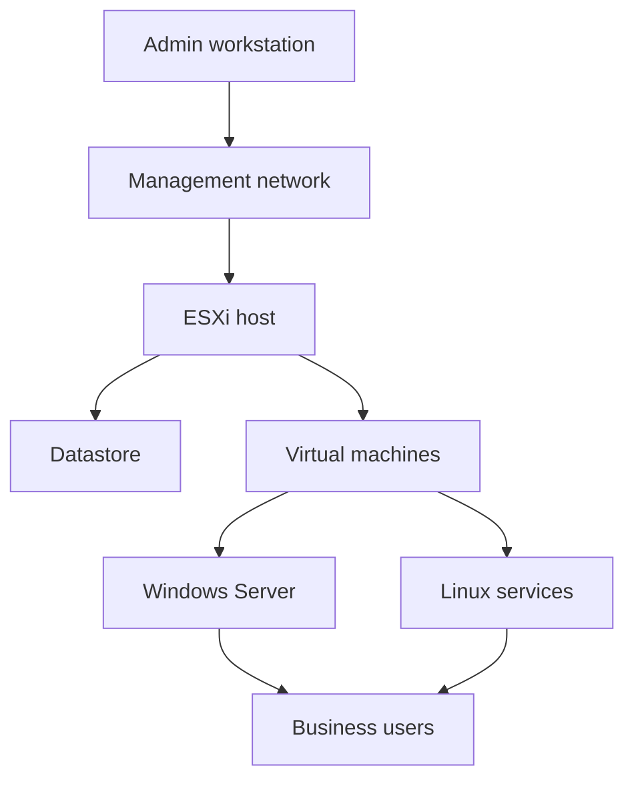

# Documentation Guide - Systems and Virtualization

Use this structure for Windows, Linux, VMware, storage, backup and server operations pages.

## Evidence labels

- **Production experience:** A description of work I have been involved in, without confidential details.
- **Sanitized reference:** A reduced/anonymized configuration or procedure.
- **Lab/demo:** An independently authored example. State the OS/hypervisor release and what was actually tested.
- **Design note:** Explains architecture, dependencies and trade-offs.
- **Template:** A reusable checklist, not a completed production record.

Keep production experience separate from lab evidence.

## Page structure

1. **Purpose and scope** - Service, platform and issue being covered.
2. **Environment** - OS/build, hypervisor/version, hardware assumptions and evidence label.
3. **Architecture** - Mermaid diagram showing host, network, storage, VM and service dependencies when useful.
4. **Prerequisites** - Access, backup, maintenance window, dependencies and permissions.
5. **Commands/configuration** - PowerShell, Bash, config snippets or UI steps with placeholders.
6. **Explanation** - What each important command changes and why.
7. **Troubleshooting** - Symptoms, logs, checks, likely causes and safe actions.
8. **Verification** - Expected service state, ports, logs, monitoring and user-side test.
9. **Rollback/recovery** - Restore point, reversal steps, data safety and escalation.
10. **What I learned** - Unexpected result, limitation, mistake corrected or next experiment.
11. **References** - Vendor documentation and related pages.

## Example architecture

## Troubleshooting record

| Symptom | Evidence to collect | Possible layer | Verification |
|---|---|---|---|
| VM powered on, service unavailable | VM events, guest logs, listening ports, vNIC and VLAN | Application/guest/network/hypervisor | Test service from client side |
| Filesystem full | `df -hT`, `df -i`, `du`, logs, LVM state | Filesystem/storage/application | Capacity and application write test |
| SMB share inaccessible | DNS, TCP 445, SMB client/server logs, share and NTFS permissions | Network/authentication/SMB | Test with an authorized account |
| Restore uncertain | Backup point, dependencies, isolated restore logs | Backup/recovery/application | Boot, data and service-owner validation |

## Safe command examples

Use placeholders and explain the impact. Commands that alter partitions, filesystems, firewall policy, permissions, services or storage must include pre-checks and a recovery plan. Do not recommend disabling security controls as a first troubleshooting step.

## Publication rules

Never publish passwords, private keys, recovery codes, real internal hostnames/IPs, serial numbers, user data or employer logs. Mark untested commands as reference examples. Do not claim a successful restore or hardware compatibility test unless it was actually performed.
