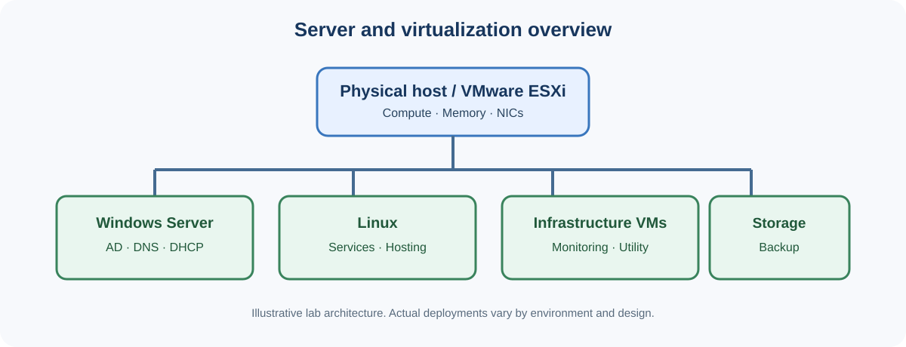

# System & Server Virtualization Portfolio

**Md. Tanvir Hossain**  
System Administration | Windows & Linux | Virtualization

This repository brings together practical notes on Windows Server, Linux, VMware, virtual machines, storage, backup, maintenance and troubleshooting. It reflects a mix of production experience, sanitized references and independent lab work.

I keep company hostnames, IP plans, backups, credentials and internal details private. If a procedure has not been tested on the stated platform, I do not present it as verified.

## What I cover

| Platform | Topics |
|---|---|
| Windows Server | Installation, AD DS, DNS, DHCP, Group Policy, file services, patching, backup and troubleshooting |
| Ubuntu Server 24.04 LTS | Users, permissions, SSH, networking, storage, services, hosting, hardening and performance |
| RHEL 9 / CentOS 8 | Packages, users, SSH, networking, services, storage, firewalld, SELinux and troubleshooting |
| VMware ESXi | Hardware readiness, hypervisor installation, management networking, datastores, vSwitches and VM lifecycle |

## Browse the repository

- [Windows Server](windows-server/README.md)
- [Ubuntu Server 24.04 LTS](linux/ubuntu-24.04/README.md)
- [Red Hat Enterprise Linux 9](linux/rhel-9/README.md)
- [CentOS Linux 8 - legacy/EOL](linux/centos-8/README.md)
- [VMware ESXi and hardware setup](vmware/esxi/README.md)
- [Virtual machines for infrastructure services](vmware/virtual-machines/README.md)
- [PowerShell examples](scripts/powershell/README.md)
- [Bash examples](scripts/bash/README.md)
- [Operations and maintenance](operations/README.md)
- [Infrastructure design references](design/README.md)
- [Server operations case studies](case-studies/README.md)

## Practical administration scripts

There are two small inventory scripts in this repository:

- [PowerShell server inventory](scripts/powershell/Get-ServerInventory.ps1) collects Windows host, adapter, IP, volume and service information. It is read-only.
- [Bash server inventory](scripts/bash/server-inventory.sh) collects Linux host, network, storage, memory and systemd information. It is read-only.

They are useful for a first look during troubleshooting or documentation. They are not a full monitoring or auditing solution. Review the output before sharing it because it may contain host and network details. Test scripts in a suitable environment before using them on production systems.

## How I approach server work

Before installing or changing a server, I check what it needs to run: compute, memory, storage, network, DNS, time synchronization, access and backup. I also look at how it will be monitored and how it can be recovered if something goes wrong.

When troubleshooting, I start with the reported symptom and recent changes. Then I check logs, service status, resource usage and dependencies. The cause may be in the hardware, hypervisor, guest OS, storage, network, identity service or application, so I try to isolate it before changing several things at once.

After a fix, I check the service from the user's point of view. For backup work, I want to know whether a restore has actually been tested. A completed backup job is useful, but it does not prove that recovery will work.

## Version notes

- Windows Server pages cover the 2022 and 2025 release families. Check edition, build, licensing and application compatibility.
- Ubuntu pages target Ubuntu Server 24.04 LTS.
- RHEL and CentOS instructions depend on the release and support lifecycle.
- CentOS 8 is end-of-life. It should not be selected for a new production deployment.
- Check VMware hardware and release compatibility before installation.

## Before using an example

The scripts and configuration examples are starting points for learning and controlled testing. Review them before running anything, especially in a production environment. The inventory scripts are read-only, but their output may still contain host or network details, so check it before sharing.

## Related portfolios

- [Network Engineering](https://github.com/thnayem/network-engineering-portfolio)
- [Enterprise IT Operations](https://github.com/thnayem/enterprise-it-operations-portfolio)
- [GitHub profile](https://github.com/thnayem)
- [LinkedIn](https://www.linkedin.com/in/thnayem/)

## Authorship

The technical work and experience described here are mine. I sometimes use AI to edit wording or organize documentation, but not to replace hands-on work or technical judgement. I review what I publish and take responsibility for it.
