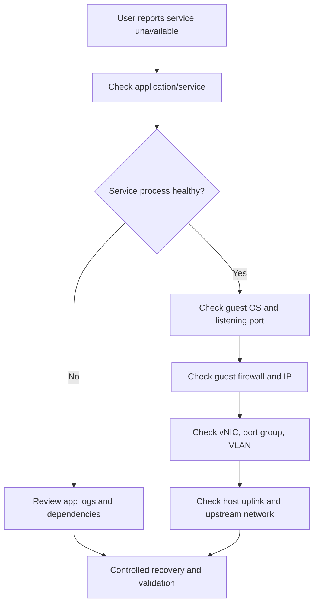
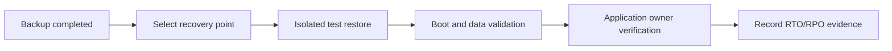

# Server & Virtualization Operations Case Studies

These walkthroughs demonstrate a disciplined troubleshooting method for Windows Server, Linux, storage, backup, and VMware environments. They are sanitized reference scenarios, not claims that every exact symptom or command was observed in a named production environment. Validate commands against the operating system and release in use.

## My troubleshooting approach

I start with service impact and evidence, not assumptions. I check what changed, identify the affected layer, preserve logs, and avoid rebooting or making multiple changes before understanding the risk.

1. Establish affected users, services, hosts, and start time.
2. Check monitoring, recent changes, system logs, capacity, and dependencies.
3. Narrow the fault to host, guest OS, storage, network, identity, or application.
4. Agree on the safest recovery action and rollback point.
5. Validate the service from the user's perspective.
6. Document the timeline, root cause, recovery, and prevention.

## Case study 1 — Virtual machine is running, but the application is unavailable

**Example symptom:** The hypervisor shows a VM as powered on, but users cannot reach the hosted application.

### Layer-by-layer path



### Checks

Linux:
```bash
systemctl status <service>
journalctl -u <service> --since "30 minutes ago"
ss -lntup
ip address
ip route
df -h
free -h
```

Windows PowerShell:
```powershell
Get-Service
Get-NetTCPConnection -State Listen
Get-NetIPConfiguration
Get-WinEvent -LogName System -MaxEvents 50
Test-NetConnection <server> -Port <port>
```

VMware checks:
- Confirm VM power state and recent tasks/events.
- Review datastore capacity and host alarms.
- Verify vNIC connected state, port group, VLAN, and uplink health.
- Check snapshots and storage latency before making changes.

**Recovery principle:** Restart only the affected service when evidence points to that service and the impact is understood. A VM power cycle is not a substitute for diagnosis.

## Case study 2 — Linux filesystem reaches critical capacity

**Example symptom:** An application starts failing to write files and monitoring reports a filesystem threshold breach.

### Investigation

```bash
df -hT
df -ih
du -xhd1 /var 2>/dev/null | sort -h
journalctl --disk-usage
find /var/log -type f -size +100M -ls
lsblk -f
lvs
vgs
```

Check both block usage and inode usage. Identify the growing directory and owning service before deleting or truncating anything. Review log rotation, application retention, temporary files, and backup staging.

**Safer remediation:** Preserve required logs, confirm retention policy, rotate or archive approved files, and expand storage only after checking the underlying virtual disk, partition, filesystem, and LVM layout.

Example LVM commands are intentionally not presented as a universal one-liner. The correct sequence depends on whether the disk, partition, PV, VG, LV, and filesystem have already been expanded.

## Case study 3 — Shared folder access fails after a Windows update or policy change

**Example symptom:** A user can reach the server but receives an access or SMB negotiation error when opening a shared folder.

### Checks

```powershell
Get-SmbClientConfiguration
Get-SmbConnection
Get-SmbShare
Get-SmbSession
Get-NetFirewallRule -DisplayGroup "File and Printer Sharing"
Test-NetConnection <fileserver> -Port 445
Get-WinEvent -LogName Microsoft-Windows-SMBClient/Connectivity -MaxEvents 30
```

Review name resolution, TCP 445 reachability, SMB dialect/security policy, signing requirements, share permissions, NTFS permissions, and the client/server event logs. Do not weaken SMB security settings as a first response. If a compatibility exception is unavoidable, document the risk, scope, approval, and expiry.

## Case study 4 — Backup job succeeded, but restore readiness is uncertain

A green backup status is not proof that a business service can be recovered.

### Practical restore-readiness workflow

1. Identify the service owner and recovery priority.
2. Record recovery dependencies: VM, database, DNS, identity, network, certificates, and application configuration.
3. Confirm backup date, retention, encryption, and repository availability.
4. Perform an approved test restore to an isolated location.
5. Validate boot, data consistency, application access, and permissions.
6. Record actual recovery time and any gap against the agreed RTO/RPO.
7. Assign remediation for missing dependencies or failed restore steps.



## Incident and maintenance record template

| Field | What to record |
|---|---|
| Incident | Ticket/reference and severity |
| Impact | Users, service, location, business effect |
| Timeline | Detection, acknowledgement, actions, recovery |
| Evidence | Logs, monitoring, event IDs, command output |
| Cause | Confirmed cause; separate from assumptions |
| Recovery | Exact action and validation |
| Follow-up | Prevention, owner, due date |
| Change | Approval, window, backup, rollback, result |

## Time and task management during an incident

- Work on service restoration before low-priority housekeeping.
- Assign a clear incident lead and separate investigation tasks where people are available.
- Keep one shared timeline so parallel work does not become conflicting work.
- Set a realistic next-update time and communicate even when there is no new technical finding.
- After restoration, schedule root-cause and preventive work instead of allowing it to disappear into the next urgent ticket.

## Safe-use boundary

Commands containing placeholders are examples. Check permissions, application dependencies, backup integrity, platform version, and organizational change policy before execution. Never publish real hostnames, IP addresses, credentials, keys, user data, or employer logs.
